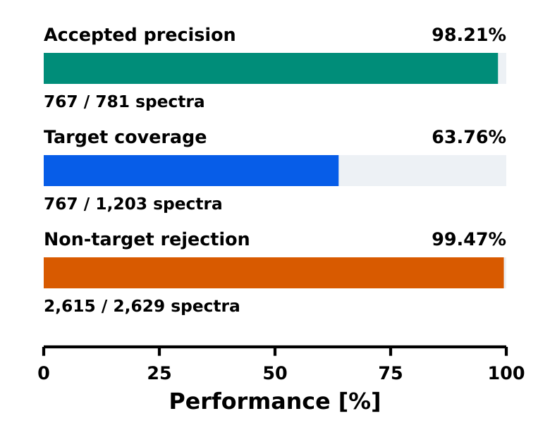
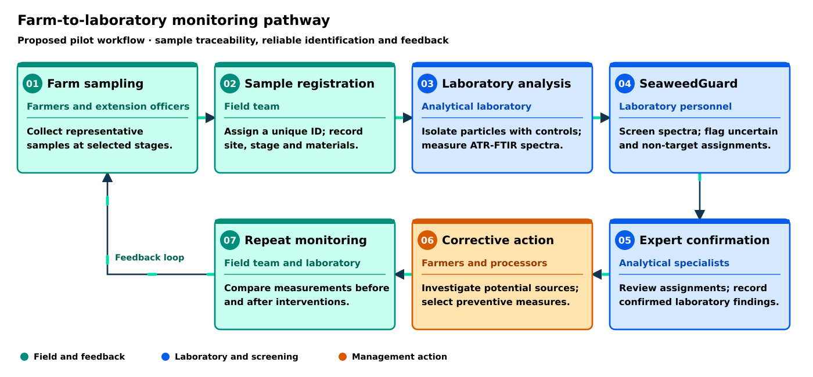

# SeaweedGuard: Intelligent Microplastic Screening for Seaweed Quality Monitoring

**Africa's Blue Futures Hackathon 2027 | Concept note v0.0.8 | 27 November 2026**  
**Proposed challenge:** Microplastics in seaweed (based on the circulated call; exact catalogue wording and submission requirements to be checked).

### 1. Problem and opportunity

Seaweed farming supports coastal livelihoods in Tanzania, employing over 23,000 farmers in Zanzibar, approximately 80% of whom are women (United Nations in Tanzania, 2026). The documented occurrence of microplastics in Tanzanian coastal environments and cultivated seaweed elsewhere highlights the relevance of contamination monitoring to the sector (Nchimbi, Kosore, et al., 2022; Nchimbi, Shilla, et al., 2022; Suryandari et al., 2025). Although infrared spectroscopy combined with computational pattern recognition has demonstrated the potential to identify environmentally weathered polymers (Ferreiro et al., 2022), the reliability of automated spectral identification remains dependent on reference libraries, spectral processing and sample condition. Kozloski et al. (2024a) reported classification accuracies ranging from 64.1% to 98.0% across spectral matching routines for distinguishing natural from synthetic materials, with high spectral similarity not consistently corresponding to correct identification. The analytical challenge is therefore to minimise incorrect assignments while retaining sufficient identification coverage for practical monitoring. This presents an opportunity to integrate reliability-aware computational screening into laboratory-supported seaweed quality monitoring. The relative importance of identification errors, instrument access, sample preparation and testing costs in the local value chain will be established through stakeholder consultation.

### 2. Proposed solution

SeaweedGuard is a web-based computational platform designed to support reliable microplastic identification in laboratory-assisted seaweed quality monitoring. It analyses ATR-FTIR spectra of isolated suspected plastic particles and identifies candidate polymers through spectral matching against a curated reference library. To address identification errors associated with environmentally altered spectra, the platform combines first-derivative spectral processing, exclusion of the 1500–1700 cm⁻¹ spectral region and similarity- and class-margin-based acceptance criteria.

The functional prototype integrates single and batch spectral analysis, interactive spectral visualisation, reference comparison, downloadable analytical results and farm observation recording. By distinguishing accepted candidates from uncertain and non-target assignments, SeaweedGuard helps laboratory personnel prioritise review and prepare interpretable records for farmers and processors. Live screening requires the authorised reference bundle; the public demonstration replays recorded results for built-in examples. Non-target assignments are not evidence that a particle is free of plastic.

**Prototype:** https://seaweedguard.streamlit.app/  
**Repository:** https://github.com/peterDataScientia/SeaweedGuard-

### 3. Innovation and evidence

Open Specy supports open spectral matching and its 2025 release includes automated processing and machine learning classifiers (Cowger et al., 2021, 2025). Validated micro-ATR-FTIR identification with quantified uncertainty also precedes SeaweedGuard (Morgado et al., 2021). SeaweedGuard's proposed innovation is the integration of selective polymer screening, explicit referral of uncertain assignments and a seaweed-oriented laboratory-to-farm monitoring workflow. Its intended advantage is decision support in a specific production context, rather than a claim of algorithmic novelty or superiority over existing platforms.

Development used published experimental spectra (Kozloski et al., 2024b). The frozen E18 method was subsequently evaluated using 3,832 ATR-FTIR spectra from the independent-source MicroPlastiX dataset (Lenz et al., 2023): 1,203 target spectra (polypropylene [PP] and polystyrene [PS]) and 2,629 non-target spectra.

| Evaluation metric | Result |
|---|---:|
| PP/PS classification accuracy before rejection | 85.37% (1,027/1,203) |
| Correct assignments among accepted PP/PS spectra | 100% (767/767) |
| Target acceptance coverage | 63.76% (767/1,203) |
| Non-target rejection rate | 99.47% (2,615/2,629) |
| Overall accepted prediction precision | 98.21% (767/781) |

*Figure 1. E18 external screening performance; each metric has a distinct denominator. Precision includes all accepted predictions, including 14 incorrect non-target acceptances.*

The acceptance rule retained 767 correctly identified target spectra and rejected or withheld 436 target spectra; 14 non-target spectra were incorrectly accepted. The results establish a precision–coverage trade-off on this dataset, not universal accuracy or independent particle-level performance. Repeated spectra may originate from the same sample. Nylon and PVC were not represented in the external evaluation; polyethylene and other non-target plastics must not be interpreted as absent when rejected. Local polymer prevalence, including the relevance of polyethylene reported in coastal waters (Nchimbi, Kosore, et al., 2022), will guide future reference-library expansion and validation. Direct comparisons with competing methods on a common external benchmark and validation on seaweed-derived particles remain necessary.

### 4. Implementation pathway

The proposed pilot will establish a collaborative monitoring service with producer groups, analytical laboratories and processing stakeholders. Its implementation will proceed through four phases, contingent on access to equipment, personnel and local samples.

| Phase | Activity and decision gate |
|---|---|
| Analytical feasibility | Confirm laboratory access, instrument-compatible particle sizes, spectral acquisition, sample handling and extraction recovery. |
| Local analytical validation | Test blinded known-polymer spikes in locally cultivated seaweed, procedural blanks and field samples; independently review assignments and assess recovery and false acceptances. |
| Operational pilot | Assess cost, turnaround, usability and traceability across selected farms and processing stages. |
| Intervention assessment | Compare suspected source materials and evaluate feasible preventive measures using comparable sampling and controls, accounting for seasonal and site variation. |

*Figure 2. Proposed farm-to-laboratory monitoring pathway linking traceable sample collection, analytical screening, expert confirmation, corrective action and repeat monitoring.*

Samples will receive unique identifiers and metadata (site, date, production stage, sample mass and relevant materials). Extraction methods will be adapted from published seaweed studies (Pereira et al., 2026) and validated locally using recovery controls and blanks. Laboratory staff will acquire spectra and review accepted and uncertain SeaweedGuard results against known materials or independent expert assessments. Verified results can inform source investigations but cannot identify sources without corroborating evidence. Repeat measurements using comparable control sites or batches will evaluate whether selected interventions are associated with reductions in confirmed contamination.

### 5. Target users and sustainability

Laboratory technicians and quality-control professionals are the primary operators, researchers and laboratories are technical partners, and farmers and cooperatives are intended beneficiaries. Processors and exporters are potential service purchasers; extension officers and producer organisations would coordinate sampling and communicate findings. These roles are proposed and will be refined through consultation, including women-led producer groups.

The proposed service uses shared laboratory infrastructure rather than requiring individual farms to purchase FTIR instruments. Institutional support, cooperative contributions and fee-based analytical services for processors or exporters are potential funding mechanisms. A pilot cost model will account for sample collection and transport, extraction reagents and consumables, instrument time, staff time, quality assurance and computing or maintenance. Cost per reportable sample, laboratory capacity, willingness to pay and distribution of costs will guide service design. No fee, saving, revenue or partner commitment is assumed. Expansion depends on analytical reliability, accessible laboratory capacity, affordable services and demand demonstrated by stakeholders.

### 6. Hackathon development and success measures

The existing MVP allows the hackathon to focus on problem validation, demonstration and implementation planning rather than rebuilding software.

| Stage | Proposed activity | Deliverable |
|---|---|---|
| Before hackathon | Confirm demo readiness; seek laboratory and producer contacts | Demonstration and partner-outreach checklist |
| Day 1 | Interview available stakeholders; test assumptions about monitoring demand and bottlenecks | Prioritised user requirements and pilot assumptions |
| Day 2 | Demonstrate live screening with authorised bundle, report export and review of rejected spectra | Demonstrated workflow and local validation protocol |
| Day 3 | Refine costs, service design, milestones and presentation | MVP pitch, draft pilot budget and partner engagement plan |
| Post-hackathon | Secure partners; conduct blinded local validation and operational pilot | Measured analytical and operational performance |

| Success indicator | Measurement |
|---|---|
| Analytical reliability | Correct accepted assignments / all accepted assignments; target acceptance coverage; false acceptance rate |
| Extraction efficiency | Recovered known particles / particles introduced, by polymer and size; procedural blank counts |
| Operational efficiency | Staff minutes per spectrum and total turnaround per sample |
| Affordability | Total TZS per reportable sample |
| Usability | Completed tasks / attempted tasks among representative operators |
| Environmental outcome | Confirmed microplastic particles per gram of dry seaweed within the validated size range, with blank correction and sampling controls |
| Social inclusion | Participation and access disaggregated by gender and stakeholder group |

Acceptance criteria and sample numbers will be specified with laboratory partners before local testing. Outcomes will be stratified by polymer, particle size and production stage; replicate measurements will be grouped by original sample. The pilot will benchmark the proposed workflow against current laboratory practice where feasible.

### 7. Expected impact and limitations

SeaweedGuard is intended to produce interpretable candidate assignments and laboratory reports that support contamination investigations. In partnership with farmers and processors, these findings could inform preventive actions and repeat monitoring. Reduced microplastic contamination, improved seaweed quality, stronger market confidence and economic benefits are long-term intended outcomes, not demonstrated effects. Inclusion will be considered through accessible shared services and participation by women-led producer groups.

The MVP cannot analyse intact seaweed directly, quantify particle concentrations from a single spectrum, establish contamination sources or certify food safety. The present evidence is spectrum-level, limited in target polymer coverage, and does not establish local extraction or field performance. Persistent traceable records, secure authorised model access, laboratory capacity and independent local validation are priorities for deployment. The public demo replays recorded examples; live inference requires the separately authorised model bundle. MicroPlastiX is licensed CC BY-SA 4.0; redistribution rights for the separate reference library and derived model bundle require their own review.

### References

Cowger, W., Karapetrova, A., Lincoln, C., Chamas, A., Sherrod, H., Leong, N., Lasdin, K., Knauss, C., Teofilovic, V., Arienzo, M., Steinmetz, Z., Pimple, S., Darjany, L., Murphy-Hagan, C., Moore, S., Moore, C., Lattin, G., Gray, A., Kozloski, R., … Maurer, B. (2025). Open Specy 1.0: Automated (hyper)spectroscopy for microplastics. *Analytical Chemistry, 97*(32), 17345–17356. https://doi.org/10.1021/acs.analchem.5c00962

Cowger, W., Steinmetz, Z., Gray, A., Munno, K., Lynch, J., Hapich, H., Primpke, S., De Frond, H., Rochman, C., & Herodotou, O. (2021). Microplastic spectral classification needs an open source community: Open Specy to the rescue! *Analytical Chemistry, 93*(21), 7543–7548. https://doi.org/10.1021/acs.analchem.1c00123

Ferreiro, B., Andrade, J. M., Paz-Quintáns, C., Fernández-González, V., López-Mahía, P., & Muniategui, S. (2022). Weathering-independent differentiation of microplastic polymers by reflectance IR spectrometry and pattern recognition. *Marine Pollution Bulletin, 181*, Article 113897. https://doi.org/10.1016/j.marpolbul.2022.113897

Kozloski, R., Cowger, W., & Arienzo, M. M. (2024a). Moving toward automated µFTIR spectra matching for microplastic identification: Addressing false identifications and improving accuracy. *Microplastics and Nanoplastics, 4*, Article 27. https://doi.org/10.1186/s43591-024-00106-5

Kozloski, R., Cowger, W., & Arienzo, M. M. (2024b). *uFTIR test spectra for known synthetic and natural materials* [Data set]. Dryad. https://doi.org/10.5061/dryad.f1vhhmh59

Lenz, R., Fischer, F., Arnold, M., Fernández-González, V., Moscoso-Pérez, C. M., Andrade-Garda, J. M., Muniategui-Lorenzo, S., & Fischer, D. (2023). *MicroPlastiX SpecDB* [Data set]. Lenz, Robin. https://doi.org/10.22000/1820

Morgado, V., Gomes, L., Bettencourt da Silva, R. J. N., & Palma, C. (2021). Validated spreadsheet for the identification of PE, PET, PP and PS microplastics by micro-ATR-FTIR spectra with known uncertainty. *Talanta, 234*, Article 122624. https://doi.org/10.1016/j.talanta.2021.122624

Nchimbi, A. A., Kosore, C. M., Oduor, N., Shilla, D. J., Shashoua, Y., Khan, F. R., & Shilla, D. A. (2022). Microplastics in marine nearshore surface waters of Dar es Salaam and Zanzibar, East Africa. *Bulletin of Environmental Contamination and Toxicology, 109*, 1037–1042. https://doi.org/10.1007/s00128-022-03620-5

Nchimbi, A. A., Shilla, D. A., Kosore, C. M., Shilla, D. J., Shashoua, Y., & Khan, F. R. (2022). Microplastics in marine beach and seabed sediments along the coasts of Dar es Salaam and Zanzibar in Tanzania. *Marine Pollution Bulletin, 185*, Article 114305. https://doi.org/10.1016/j.marpolbul.2022.114305

Pereira, R., Almeida, C. M. R., & Ramos, S. (2026). Optimization of an analytical methodology to determine microplastic contamination in different seaweed groups (Phaeophyceae, Rhodophyta and Chlorophyta). *MethodsX, 16*, Article 103816. https://doi.org/10.1016/j.mex.2026.103816

Suryandari, R., Sudrajat, & Nugroho, A. P. (2025). Microplastic contamination on cottonii seaweed (*Kappaphycopsis cottonii*) cultivated in Bomo Beach, Banyuwangi, East Java, Indonesia. *EnvironmentAsia, 18*(1), 13–23. https://doi.org/10.14456/ea.2025.2

United Nations in Tanzania. (2026, July 13). *Zanzibar’s seaweed sector draws global interest*. https://tanzania.un.org/en/319757-zanzibar%E2%80%99s-seaweed-sector-draws-global-interest

**Draft status:** Revised for internal review on 27 November 2026. Official challenge catalogue and submission format could not be retrieved. Partner commitments, local pilot outcomes and service costs remain unverified. E18 figures are project-reported; independent CI and deployed-interface verification remain outstanding. Reference metadata was checked against available publisher and repository records; this is not a systematic literature search.
