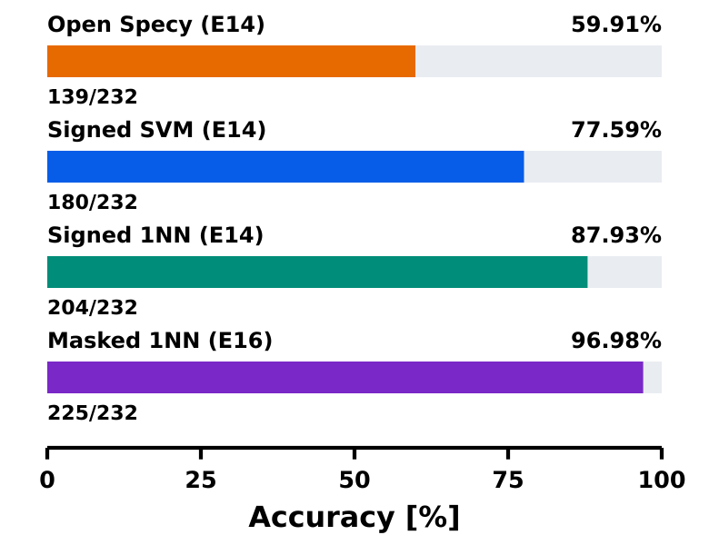
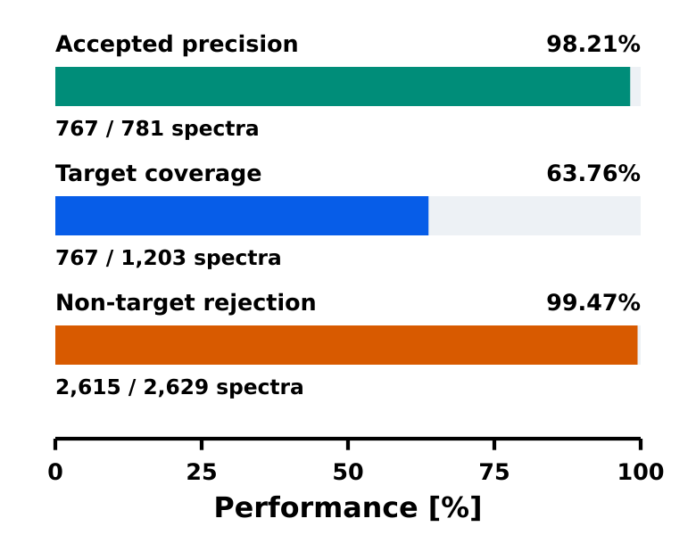
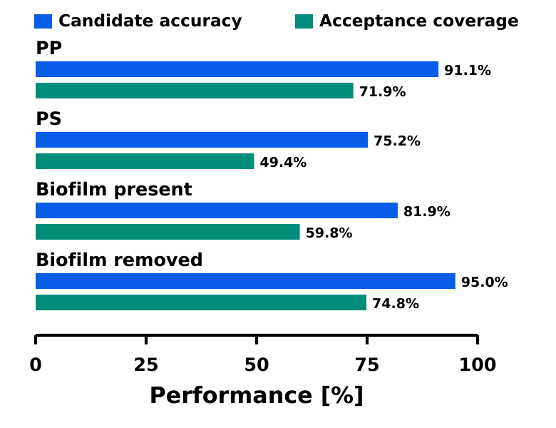

# SeaweedGuard: Scientific Validation Report

**Version:** v0.0.1 | 27 November 2026  
**Application:** SeaweedGuard v1.0.0 — Hackathon MVP  
**Companion:** [Concept note v0.0.8](SeaweedGuard_Concept_Note_v0.0.8.md)

## Executive summary

SeaweedGuard is a selective spectral screening system for measured infrared spectra of isolated suspected plastic particles. The development programme progressed from raw-data quality control through exploratory polymer classification, restricted-library comparison with Open Specy, spectral-region sensitivity analysis, reference-only threshold selection and an external-source ATR-FTIR evaluation. The application is intended to support laboratory-assisted seaweed quality monitoring, not to replace particle isolation, spectroscopic measurement or expert confirmation.

The frozen E18 method correctly classified 1,027 of 1,203 polypropylene (PP) and polystyrene (PS) target spectra before rejection (85.37%). It accepted 767 target spectra, all correctly identified, and incorrectly accepted 14 of 2,629 non-target spectra. Overall precision among accepted assignments was 98.21% (767/781), target acceptance coverage was 63.76% (767/1,203) and non-target rejection was 99.47% (2,615/2,629). Re-execution of the archived E18 script from the original MicroPlastiX archive on 27 November reproduced all 3,832 saved candidate assignments, acceptance decisions, reference IDs and numerical similarity and margin values exactly.

These results support reproducible, selective spectral screening on the tested collection. They do not establish analytical recovery, concentration estimates, universal polymer identification accuracy, specimen-level independence, local seaweed-matrix validity or the effectiveness of farm interventions.

## 1. Scientific question and validation scope

Can computational matching of environmentally altered infrared spectra yield reliable candidate polymer identifications while withholding assignments that are insufficiently supported, and can this approach form the analytical component of a laboratory-to-farm monitoring workflow?

The primary outcomes are candidate classification accuracy, acceptance coverage, precision among accepted predictions and rejection of spectra outside the four target polymer families. The spectral unit of analysis is a measured spectrum, not necessarily an independent particle, sample or farm. Analytical feasibility of the broader seaweed application is a separate objective requiring prospective local validation.

## 2. Data sources and quality control

### 2.1 Development collection: E01–E02

The development data are published transmission-mode micro-FTIR spectra of known synthetic and natural materials (Kozloski et al., 2024). The archive documents percent absorbance, an 8 cm⁻¹ instrumental resolution and a nominal 675–4000 cm⁻¹ range. Spectra from four polymers were measured after 15 days of river exposure in the Mekong and hydrogen peroxide treatment, with wet/dry storage conditions. These are not direct measurements of contaminated seaweed tissue.

E01 identified 926 CSV records (588 in the test collection and 338 in the biofouling collection), 756 unique numerical arrays, 123 exact numerical duplicate groups and 100 unique arrays occurring across libraries. Two records had an irregular wavenumber axis. Source folders could contain conflicting labels, so E02 conservatively quarantined conflicts and invalid axes.

| E02 audit disposition | Records |
|---|---:|
| Initial records | 926 |
| Retained eligible spectra | 686 |
| Quarantined conflicting records | 185 |
| Redundant copies | 53 |
| Quarantined invalid axes | 2 |
| Retained pristine spectra | 454 |
| Retained exposed spectra | 232 |

The retained exposed cohort comprises 57 Nylon, 62 PP, 52 PS and 61 PVC spectra; 119 were from dry-storage and 113 from wet-storage conditions. Specimen identities were not fully resolved; duplicate exclusion does not establish independent specimens. Label assignments remain based on the reviewed material metadata.

Source records: [E01 notebook](../notebooks/E01_Raw_Spectral_Data_Audit.ipynb), [E01 executed audit](E01_audit_results.md). The E02 manifest and clean index were inspected in the archived project output files during preparation of this report.

### 2.2 Common reference library

The Open Specy FTIR metadata audit screened 42,628 records, excluded 418 entries attributed to Rachel Kozloski, and selected 459 unique reference identities from two previously published sources: Primpke et al. (2018), 123; FLOPP (De Frond et al., 2021), 336. The remaining 41,751 records were not selected pending additional review. This is a deliberately restricted, source-audited reference subset, not the full Open Specy library.

| Frozen model family | References |
|---|---:|
| Nylon | 21 |
| PP | 91 |
| PS | 21 |
| PVC | 21 |
| Other | 305 |
| Total | 459 |

Reference label harmonisation used material, material class and spectrum identity fields; aromatic aramids were not treated as Nylon. In E14–E15 SVM training, detailed non-target labels were retained before collapsing predictions to Other. The frozen nearest-reference model uses five operational classes. Source-level separation reduces direct provenance overlap but cannot establish sample-level independence. See the [reference audit](reference_provenance_audit.md) and [corrected common-reference implementation](../openspecy/common_reference.py).

### 2.3 External collection: E18

The independent-source MicroPlastiX SpecDB archive (DOI 10.22000/1820) contains 5,809 metadata rows: 3,832 ATR and 1,977 Raman. The analysis retained ATR only. All 3,832 ATR spectra passed the implemented finite-value, unit, axis and spectral-coverage checks; all had distinct recorded spectral hashes. The analysis retained 300 metadata-defined groups (94 target and 206 non-target). These groups are proxies, not confirmed independent particles.

| Polymer | Spectra | E18 role |
|---|---:|---|
| PP | 768 | Target |
| PS | 435 | Target |
| HDPE | 492 | Non-target |
| LDPE | 444 | Non-target |
| PE | 36 | Non-target |
| PET | 1,210 | Non-target |
| PLA | 447 | Non-target |
| Total | 3,832 | |

Nylon and PVC were absent. The data contain weathered and biofilm-associated polymer measurements, not a local seaweed extraction study. E18 tests transfer from development transmission micro-FTIR spectra to an external ATR source, with no claim that the modality or sample-condition distributions are equivalent.

## 3. Experimental development and model selection

The following is an evidence-based reconstruction of the experiment sequence. E03–E10 are reported collectively because the archived benchmark summary does not resolve every individual experiment. E11–E13 describe the baseline preparation, provenance review and shared-reference reconciliation; E14–E18 have individual archived result tables. The development cohort was inspected repeatedly and is therefore not a fresh external test set.

| Stage | Purpose | Recorded result or decision |
|---|---|---|
| E01 | Raw data audit | Duplicate groups and axis anomalies identified. |
| E02 | Conservative cleaning | 686 retained spectra; 232 exposed. |
| E03–E10 | Initial PP/PVC classification and abstention | Correlation 1NN selected as promising; additional multiclass exploration conducted. |
| E11–E13 | Open Specy comparison and source audit | Percent absorbance confirmed, source-restricted 459-reference subset selected; incomplete export and nonfinite reference issues investigated. |
| E14 | Corrected common-reference comparison | Signed derivative 1NN: 204/232 correct. |
| E15 | Matched preprocessing sensitivity | Signed derivative improved on absolute derivative in tested 1NN and SVM pipelines. |
| E16 | Spectral-region ablation | Omitting 1500–1700 cm⁻¹ gave 225/232 correct on the development cohort. |
| E17 | Reference-only calibration | Similarity and margin thresholds derived from group-held-out reference matches. |
| E18 | External-source evaluation | Frozen rule applied to 3,832 MicroPlastiX ATR spectra. |

### 3.1 Initial binary and multiclass experiments

The initial PP/PVC benchmark used 55 pristine training spectra (28 PP and 27 PVC) and 123 exposed spectra (62 PP and 61 PVC). Preprocessing was a Savitzky–Golay first derivative (window 11, polynomial order 2), mean centring and L2 normalisation. Five-fold stratified row cross-validation was diagnostic; specimen-level independence was unverified.

| Model | Row-CV balanced accuracy | Exposed balanced accuracy | Exposed macro-F1 |
|---|---:|---:|---:|
| Correlation 1NN | 96.36% | 99.18% | 99.19% |
| RBF SVM | 96.36% | 97.57% | 97.56% |
| Random forest | 96.36% | 97.55% | 97.56% |

The initial nearest-reference rule accepted 87/123 exposed spectra; 86/87 were correct (98.85%). The sole correlation classification error was accepted. This was neither a calibrated probability nor an open-set evaluation.

The later exploratory multiclass benchmark used 454 pristine spectra and 232 exposed spectra. Diagnostic row CV on 450 pristine rows from 16 classes with at least five spectra gave balanced accuracies of 97.89% (1NN) and 99.02% (SVM); similarity-grouped CV produced similar results. However, exposed balanced accuracies using 18 reference classes were only 67.93% and 68.01%, respectively. Both classifiers gave 160/232 exact folder-label matches. Combining Nylon fibres and fragments at chemistry-family level increased the 1NN count to 210/232; this changed the endpoint, not the model. These results motivated source-audited reference matching and endpoint harmonisation rather than reliance on pristine cross-validation.

Records: [E03–E10 benchmark](E03_E10_benchmark.md); [Phase II multiclass benchmark](phase2_benchmark.md).

### 3.2 E14: restricted-library Open Specy comparison

Open Specy is an established external software baseline (Cowger et al., 2021). The archived R matching outputs and Python methods were compared using 232 exposed queries, common reference identities and harmonised target-family labels. Matching preprocessing was not identical across the official baseline and Python pipeline.

| Method | Correct / total | Accuracy | Balanced accuracy | Target macro-F1 |
|---|---:|---:|---:|---:|
| Open Specy | 139/232 | 59.91% | 58.17% | 0.608 |
| Signed derivative 1NN | 204/232 | 87.93% | 87.88% | 0.873 |
| Signed derivative SVM | 180/232 | 77.59% | 77.28% | 0.843 |

The 1NN method alone was correct on 67 spectra and Open Specy alone on two. The archived exact McNemar p-value is 8.19 × 10⁻¹⁸; specimen clustering was unresolved, so this is a row-level descriptive diagnostic, not definitive independent-sample inference. The result does not establish superiority over full-library Open Specy or its newer releases.

The initial E13 reference export had missing/nonfinite intensities and stopped before completion. Subsequent code selected the largest contiguous complete spectral intersection without imputation and corrected chemistry-level labels. The initial failure was not treated as a completed experiment. See the [Colab entrypoint](../notebooks/E11_OpenSpecy_Benchmark.ipynb) and [corrected E14 implementation](../openspecy/common_reference.py).

### 3.3 E15: matched derivative preprocessing

| Pipeline | Correct / 232 | Accuracy |
|---|---:|---:|
| Signed derivative 1NN | 204 | 87.93% |
| Absolute derivative 1NN | 180 | 77.59% |
| Signed derivative SVM | 180 | 77.59% |
| Absolute derivative SVM | 149 | 64.22% |

On this cohort, signed derivatives retained useful discriminatory information relative to taking absolute derivative values. The comparison isolates the tested preprocessing change more directly than the official Open Specy comparison; it remains exploratory and does not describe every Open Specy configuration.

### 3.4 E16: spectral-region sensitivity

The full signed derivative grid yielded 204/232 correct. Among the tested leave-region-out configurations, removing 1500–1700 cm⁻¹ yielded 225/232 (96.98%), including an increase in Nylon recall from 34/57 to 55/57. Region selection was made on the previously inspected exposed cohort. Consequently 96.98% is a development result and cannot be reported as fresh external validation. The empirical improvement does not prove a biochemical mechanism or establish that the excluded region is universally detrimental.

*Figure 1. E14 common-reference benchmark and E16 exploratory mask selection on the same 232 exposed spectra.*

### 3.5 E17: reference-only rejection rule

Reference spectra were grouped by connected components of derivative similarity ≥0.995. Same-group references were excluded from held-out matching. The lower fifth percentiles of similarity and margin among correctly predicted held-out target reference spectra determined thresholds. The masked configuration had 292 reference groups, 154 target references and 153 correctly predicted group-held-out target references used in calibration.

| Configuration | Similarity threshold | Class-margin threshold |
|---|---:|---:|
| Full grid | 0.882376 | 0.066767 |
| Masked grid (selected) | 0.879220 | 0.058389 |

The fifth-percentile thresholds are heuristic reference-derived cutoffs, not calibrated probabilities or guarantees of 95% accuracy. Their conjunction may reject more than 5% of spectra.

| Development rejection outcome, selected mask | Count |
|---|---:|
| Correct accepted exposed targets | 34/34 |
| Target coverage | 34/232 (14.66%) |
| Pristine non-target rejection | 355/370 (95.95%) |
| Non-target false acceptances | 15 |
| Precision among all accepted spectra in this combined evaluation | 34/49 (69.39%) |

The E17 target and non-target cohorts differ in condition and composition. This combined precision is not a prevalence-adjusted estimate or directly comparable to E18 precision. It reveals a substantial coverage limitation and motivates external evaluation.

## 4. Frozen E18 method

The [frozen inference engine](../frozen_engine.py) was inspected directly. It converts input units, validates finite values, unique ascending wavenumbers and adequate coverage, and interpolates onto a 750-point grid (1002.845–3891.810 cm⁻¹). The first derivative is computed using a Savitzky–Golay window of 11 and polynomial order 2. The mask excludes points satisfying 1500 ≤ wavenumber < 1700 cm⁻¹, leaving 698 points. The retained derivative vector is mean-centred and L2-normalised.

For normalised query vector q and reference vector r, similarity is their signed dot product. For each family k, the class score is the maximum similarity over reference spectra assigned to k. The candidate is the family with the largest class score, and the margin is its score minus the second-largest class score. Acceptance requires the candidate not to be Other, similarity ≥0.879220 and class margin ≥0.058389. Otherwise the spectrum is referred for review or marked as a non-target candidate. Other does not mean non-plastic.

The frozen reference bundle contains 459 vectors × 698 retained points and four target polymer families plus Other. The reference library is subject to a separate redistribution-rights review. The model does not require neural-network inference, and the score is not a posterior probability.

## 5. E18 external-source results

### 5.1 Primary performance

| Endpoint | Numerator / denominator | Result |
|---|---:|---:|
| Candidate accuracy among PP/PS targets | 1,027/1,203 | 85.37% |
| Correct among accepted PP/PS targets | 767/767 | 100% |
| Target acceptance coverage | 767/1,203 | 63.76% |
| Precision among all accepted assignments | 767/781 | 98.21% |
| Non-target rejection | 2,615/2,629 | 99.47% |
| Non-target false acceptance | 14/2,629 | 0.53% |
| All-spectrum acceptance | 781/3,832 | 20.38% |

There were 436 withheld target spectra and 14 false accepted non-target spectra: five LDPE assigned PP and nine PET assigned PS. The conditional 100% target result excludes these errors and must always be accompanied by overall precision and coverage. Neither figure represents performance at an arbitrary target prevalence.

*Figure 2. E18 precision, target acceptance coverage and non-target rejection, with distinct denominators.*

### 5.2 Candidate confusion matrix before rejection

| True polymer | Nylon | Other | PP | PS | PVC |
|---|---:|---:|---:|---:|---:|
| HDPE | 0 | 486 | 0 | 6 | 0 |
| LDPE | 0 | 419 | 18 | 7 | 0 |
| PE | 0 | 34 | 0 | 2 | 0 |
| PET | 1 | 1,199 | 1 | 9 | 0 |
| PLA | 0 | 436 | 0 | 11 | 0 |
| PP | 0 | 49 | 700 | 19 | 0 |
| PS | 0 | 107 | 0 | 327 | 1 |

This table records candidate assignments before applying the rejection criteria. It is not an accepted-only confusion matrix.

### 5.3 Polymer and biofilm strata

| Stratum | Target spectra | Candidate correct | Accepted targets | Candidate accuracy | Coverage |
|---|---:|---:|---:|---:|---:|
| PP | 768 | 700 | 552 | 91.15% | 71.88% |
| PS | 435 | 327 | 215 | 75.17% | 49.43% |
| Biofilm present (bio) | 885 | 725 | 529 | 81.92% | 59.77% |
| Biofilm removed (nobio) | 318 | 302 | 238 | 94.97% | 74.84% |

All accepted target spectra in these strata were correct. The non-target false acceptances occurred in the bio stratum (14/1,919); none occurred in the nobio stratum (0/710). Differences by treatment are descriptive, because the strata may differ in polymer composition, sample origin and other conditions. They do not identify a causal effect of biofilm removal.

*Figure 3. Candidate accuracy and acceptance coverage across E18 target strata. Polymer and treatment strata are overlapping summaries, not independent experimental groups.*

### 5.4 Dependence and near-reference sensitivity

There were 300 metadata-defined groups; the equal-group mean target candidate accuracy was 83.95%, compared with the spectrum-weighted 85.37%. The equal-group mean non-target false acceptance fraction was 0.69%. These estimates do not establish independently sampled groups.

Forty-eight spectra had maximum reference similarity ≥0.995 and none ≥0.999. Excluding the 48 near-reference records yielded 1,024/1,200 correct target candidates (85.33%), 764/1,200 accepted targets (63.67%), 764/778 overall accepted precision (98.20%) and 2,570/2,584 non-target rejection (99.46%). Similarity is a sensitivity indicator, not proof of duplicated specimens. No confidence intervals assuming independent spectra are presented.

## 6. Computational reproducibility and application status

On 27 November 2026 the archived E18 Python scoring script was rerun from the original MicroPlastiX archive, reference CSV, label mapping and development-grid file. The newly generated predictions were joined one-to-one by source filename against the archived predictions.

| Regression check | Result |
|---|---:|
| Matched filenames | 3,832 |
| Candidate discrepancies | 0 |
| Accepted-status discrepancies | 0 |
| Reference ID discrepancies | 0 |
| Truth-label discrepancies | 0 |
| Maximum absolute similarity difference | 0.0 |
| Maximum absolute margin difference | 0.0 |

This verifies computational repeatability of the archived scorer in the current environment. It is not another external validation dataset and is not an end-to-end test of the deployed Streamlit UI. The frozen engine implements the same specified rule; the user previously confirmed satisfactory prototype operation, but independently verified browser automation and current CI results are unavailable.

The public application contains recorded E18 example replay. Live analysis of arbitrary spectra requires the authorised frozen reference bundle. Farm logs and analysis history are session-based; they are not yet a durable traceability database.

### 6.1 Source integrity and reproducibility records

| Artefact | SHA-256 |
|---|---|
| Dryad original ZIP | `2e50dadad8bff263fd6300ec4cbb8846e4a1debc78103a3e1205d1ada91caf67` |
| MicroPlastiX TAR | `99bd681e72399f9205f3456877441f589e6b10b4fcf5b338db64c9eeb3511d96` |
| Local frozen model NPZ inspected for this report | `9930e9df1a68b9cc2fcd1ae31cf55c926ae88f6160beeb039fc3284ac33b5ff5` |

Archived result files inspected: E02 manifest and clean index; E14 metrics, paired tests and reference label mapping; E15 metrics and paired tests; E16 region metrics and class recall; E17 calibration thresholds, metrics and scoring code; E18 predictions, confusion matrix, coverage audit, group summary, metrics and scoring code. The reproduced E18 results were stored separately from the original results. Raw spectra and the frozen reference bundle are not redistributed by this report.

## 7. Interpretation and remaining validation

The evidence supports a reproducible screening rule that can withhold insufficiently supported assignments. It does not show that SeaweedGuard has greater general-purpose accuracy than other platforms, since the restricted-library benchmark used the development cohort and no matched competing-method E18 comparison was performed. The selected region and thresholds may fail for unfamiliar polymers, instruments, spectral ranges or local matrices. Polyethylene is especially important for future coverage because it is currently non-target, and rejected PE spectra are not negative contamination findings.

A local pilot must distinguish extraction recovery from computational classification, and must evaluate the whole workflow under representative conditions.

| Validation gate | Proposed evidence |
|---|---|
| Laboratory feasibility | Confirm instrument access, compatible particle sizes, spectral export, blanks and extraction suitability. |
| Local analytical validation | Blinded known-polymer spikes in local seaweed, independent reference confirmation, recovery and blank counts, polymer-specific precision and coverage. |
| Operational validation | Grouped sample records, analyst time, reportable sample cost, task completion, expert-review burden and comparison with current practice. |
| Field intervention | Representative sample masses, validated size range, confirmed particles per gram dry seaweed, comparable control sites/batches and seasonal variation. |

Acceptance criteria and sample sizes should be specified prospectively with laboratory partners. The study should include Nylon, PVC, PE and other locally relevant materials, assess matrix effects, and retain rejected/invalid spectra in the audit trail. Confirmed polymer identity alone cannot establish particle source or food safety. Stakeholder demand, economic feasibility, contamination reduction and social benefits remain proposed outcomes.

## 8. Conclusion

SeaweedGuard has progressed beyond a conceptual proposal: it has a working user-confirmed MVP, a documented reference-based method, a restricted comparative benchmark and a reproducible external-source evaluation. The E18 results demonstrate high precision among accepted predictions on the tested cohort, with an explicit cost in target coverage and some non-target false acceptances. The next scientific priority is a blinded local analytical pilot and operational assessment rather than further tuning on the same development spectra.

## References and primary evidence links

Bibliographic entries below use author–date style where verified in the project records. DOI-linked datasets and library sources identify the exact underlying evidence; full metadata for the MicroPlastiX citation should be exported from its repository before a formal publication submission.

- Cowger et al. (2021). *Microplastic spectral classification needs an open source community: Open Specy to the rescue!* https://doi.org/10.1021/acs.analchem.1c00123
- De Frond et al. (2021). FLOPP spectral library source. https://doi.org/10.1021/acs.analchem.1c02549
- Kozloski, R., Cowger, W., & Arienzo, M. M. (2024). *uFTIR test spectra for known synthetic and natural materials* [Data set]. Dryad. https://doi.org/10.5061/dryad.f1vhhmh59
- MicroPlastiX SpecDB [Data set]. https://doi.org/10.22000/1820
- Primpke et al. (2018). Reference spectral library source. https://doi.org/10.1007/s00216-018-1156-x

**Report status:** Internal validation report; based on inspected project records and a fresh E18 computational rerun. Earlier experiment-level results are reported only where recoverable from archived summaries. No new wet-laboratory measurements, partner commitments or field outcomes are claimed. Figures are Figentra-style SVG adaptations; independent browser rendering and complete APA metadata verification remain outstanding.
